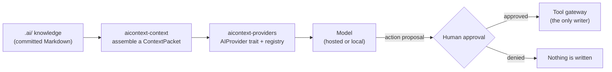
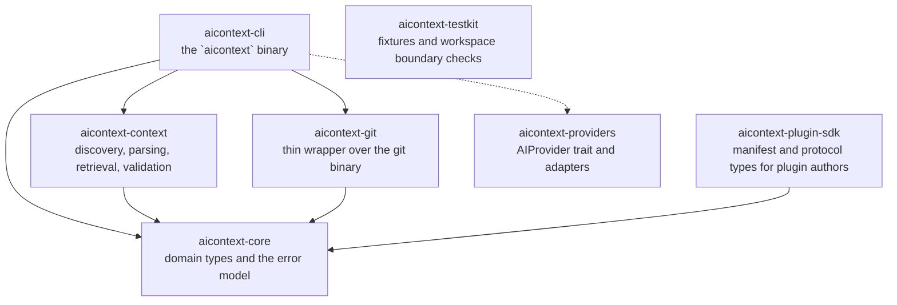

# AI Context OS

> **Git-native context, memory, governance, and tool integration for AI-assisted development.**

[](https://github.com/Vinit010/AI-Context-OS/actions/workflows/ci.yml)
[](LICENSE)
[](rust-toolchain.toml)
[](#status)

AI coding agents are individually capable and collectively unreliable, because they are *stateless
with respect to the project*. AI Context OS gives them a persistent, structured, reviewable
understanding of a repository, and gives you a control plane over what they are allowed to do.

The deliverable is a **local-first CLI named `aicontext`**, written in Rust, shipping a single static
binary. Project knowledge lives in the repository as plain Markdown, so it is versioned, reviewable,
and portable between machines and between AI tools.

| Promise | What it means |
|---------|---------------|
| **AI models change. Project knowledge persists.** | The knowledge lives in the repository, not in a vendor's chat history. |
| **Code changes often. Decisions stay traceable.** | Every architectural choice and fixed bug is a versioned artifact with a recorded reason. |
| **AI assists; the developer decides.** | Dangerous actions require explicit human approval, and every consequential action is auditable. |

---

## Contents

- [Status](#status)
- [Quick start](#quick-start)
- [How it works](#how-it-works)
- [Features](#features)
- [Repository layout](#repository-layout)
- [Requirements](#requirements)
- [Build and test](#build-and-test)
- [Commands](#commands)
- [Contributing](#contributing)
- [Documentation](#documentation)
- [License](#license)

---

## Status

**Specification complete. Implementation in progress (Phase 3 of 11).**

| Phase | Scope | State |
|-------|-------|-------|
| 0 | Specification and architecture | Done |
| 1 | Context MVP: `init`, `status`, `doctor`, `export`, `import` | Done |
| 2 | Discovery, indexing, retrieval, budgets, `health`, `context` | Done |
| 3 | AI provider layer (plan mode only) | In progress |
| 4 | Plugin system, permissions, audit | Not started |
| 5-7 | GitHub plugin, AWS plugin, hardening | Not started |
| 8-10 | Dashboard, multi-agent, marketplace | Deferred |

**Seven commands ship today: `init`, `status`, `doctor`, `health`, `context`, `export`, and `import`.**

`init` creates the `.ai` skeleton, `status` reports where the project and its task register stand,
`doctor` validates the `.ai/` tree and explains what is wrong with it, `health` reports transparent
context metrics, `context` assembles a context packet for a task or query, `export` writes a
deterministic archive of `.ai/` with a digest manifest, and `import` verifies such an archive and
restores it without ever overwriting a file without `--force`.

Every other command in the plan refuses to run and names the task that will build it. Phase 3 defines
the provider abstraction — provider-neutral request/response types, the `AIProvider` trait, and the
registry — so the first real adapter can land without touching any other crate. The task register in
[`.ai/TASKS.md`](.ai/TASKS.md) is the authoritative list of what is being built, in what order, and
what "done" means for each item.

```sh
cargo run -p aicontext-cli -- init --dry-run   # show the plan, write nothing
cargo run -p aicontext-cli -- init             # create .ai/
```

`init` writes the skeleton, appends one `.gitignore` entry, and never touches anything else. A second
run reports every document as unchanged; an edited document is preserved rather than overwritten.

---

## Quick start

```sh
# 1. Build the binary from source.
cargo build --release --locked -p aicontext-cli

# 2. Scaffold a project (write nothing yet).
cargo run -p aicontext-cli -- init --dry-run

# 3. Create the .ai/ knowledge tree.
cargo run -p aicontext-cli -- init

# 4. Ask where the project stands.
cargo run -p aicontext-cli -- status

# 5. Check the tree is healthy.
cargo run -p aicontext-cli -- doctor

# 6. Assemble the context a model would be given for a task.
cargo run -p aicontext-cli -- context --task TASK-001
```

Every command has a documented exit code and a machine-readable `--json` mode, and works without a
TTY. Read commands never touch the network, and anything that writes supports `--dry-run`.

---

## How it works

Project knowledge is committed to the repository under `.ai/`. The CLI reads it, assembles a
**context packet** for a specific task, and — once the provider layer lands — hands that packet to a
model as *plan mode only*: the model proposes, the human approves, and only then does anything with
write access run. The flow below is the target shape; today the context engine and the provider
interface exist, and the adapter and approval broker arrive in later phases.



Everything the agent knows is plain files in the repository:

```text
.ai/
  AI.md              # agent entry point and the mandatory workflow
  PRD.md             # what the product is and why
  ARCHITECTURE.md    # crate graph, storage model, runtime flows
  RULES.md           # engineering rules with justifications
  CONVENTIONS.md     # naming, layout, error handling
  DESIGN.md          # index into specs
  TASKS.md           # the task register
  MEMORY.md          # durable decisions and open questions
  specs/             # feature specifications
  context/           # domain knowledge, terminology, environments
  tasks/             # one file per task
  decisions/         # ADRs: one decision, one file, one reason
  bugs/              # bug memory: what broke and why
  changes/           # change history
  workflows/         # recurring procedures
  agents/            # agent role profiles
  integrations/      # external system notes
  permissions/       # permissions.yaml
  schemas/           # JSON Schema, materialised by the CLI
```

Working state that should never be committed lives in `.aicontext/`, which is git-ignored.

Two properties are enforced in CI and by review, not by convention alone:

- **`.ai/` is committed, `.aicontext/` is not.** Knowledge persists; scratch state does not.
- **Agents cannot write outside a plan.** A change is proposed, reviewed, and only then applied.

---

## Features

| Area | Capability |
|------|------------|
| **Durable project memory** | Requirements, architecture, rules, decisions, bugs, and task state as versioned Markdown under `.ai/`. |
| **Assembled context** | A bounded, provenance-carrying `ContextPacket` per task, with a transparent retrieval plan and budget report. |
| **Validation you can trust** | `doctor` reports stable `CTX-*` codes with the exact fix, and never silently repairs the tree. |
| **Provider-neutral by design** | `CompletionRequest`/`CompletionResponse` are provider-agnostic; adding an adapter touches no other crate. |
| **Honest metrics** | `health` reports counts it can source, each with the command that reproduces it, and no composite score. |
| **Portable archives** | `export`/`import` round-trip `.ai/` deterministically, with a SHA-256 digest per file. |
| **Local-first** | Single static binary, no runtime prerequisite, no telemetry, and read commands never touch the network. |

---

## Repository layout



`aicontext-plugin-sdk` is a library for plugin authors and depends on `aicontext-core` only.

`aicontext-providers` is in the workspace with its interface defined, and is not yet wired to the CLI
(dashed); `aicontext-testkit` has no crate dependencies of its own — it reads every other crate's
manifest to enforce the boundary policy in CI.

```text
crates/
  aicontext-core           # domain types and the error model. Depends on nothing internal.
  aicontext-context        # document discovery, parsing, retrieval, validation
  aicontext-git            # thin wrapper over the git binary
  aicontext-plugin-sdk     # manifest and protocol types for plugin authors
  aicontext-providers      # AIProvider trait, neutral types, and the registry
  aicontext-cli            # the `aicontext` binary
  aicontext-testkit        # test support: manifest reader, boundary policy
.ai/                       # the project's own context, dogfooding the product
docs/                      # normative specifications
.github/workflows/         # CI
```

Three more crates are specified but do not exist yet: `aicontext-plugin-runtime`,
`aicontext-permissions`, and `aicontext-audit`. They are added by the task that needs them, and never
speculatively. `aicontext-plugin-sdk` depends on `aicontext-core` only, so a plugin author never
links the runtime or the CLI.

The dependency graph is a DAG pointing inward toward `aicontext-core`, and it is checked by
`crates/aicontext-testkit/tests/crate_boundaries.rs` on every CI run. Adding a workspace member
without declaring what it may depend on fails the build.

---

## Requirements

- **Rust 1.85 or newer.** That is the **MSRV**, declared as `rust-version` in the workspace
  `Cargo.toml` and proved real by a dedicated CI job, not by assertion.
- [`rust-toolchain.toml`](rust-toolchain.toml) pins the toolchain that local builds, CI, and release
  artefacts all use — currently 1.95.0 — so `rustup` installs it for you, and a contributor is never
  forced off their own stable to match. Update the pin deliberately, in its own commit.
- `git` on `PATH`.

No C compiler and no system library are needed: every dependency is pure Rust.

Third-party crates are added only with a written justification in
[`.ai/ARCHITECTURE.md`](.ai/ARCHITECTURE.md) §2.2 or a decision record. The tree currently carries
nine in production — `thiserror` for typed errors, `yaml_serde` for YAML, `ignore` for
`.gitignore`-aware file discovery, `clap` for the command tree, `serde` with `serde_json` for the
published `--json` envelope, `sha2` for the SHA-256 digests in `export`/`import`, and `async-trait`
with `futures-core` for the async, dyn-safe `AIProvider` interface — plus `proptest`, `tempfile`,
`jsonschema`, and `futures-executor` for tests. The YAML library is reached only through a private
two-method trait, so no YAML type appears in a public signature and a future swap touches one module;
see [`ADR-007`](.ai/decisions/ADR-007-yaml-codec-choice.md).

## Build and test

```sh
cargo build --workspace --locked                       # build everything
cargo test --workspace --locked                        # run the test suite
cargo fmt --all --check                                # formatting must be clean
cargo clippy --workspace --all-targets --all-features --locked -- -D warnings
RUSTDOCFLAGS="-D warnings" cargo doc --workspace --no-deps --locked
cargo audit                                            # no known vulnerabilities
```

Parser properties run 1,000 cases by default; raise the count for a longer soak:

```sh
PROPTEST_CASES=10000 cargo test -p aicontext-context --locked
```

---

## Commands

```text
aicontext
├─ init                     create the .ai skeleton                          available
├─ status                   project, branch, phase, current task, changes    available
├─ doctor                   validate and diagnose context                    available
├─ health                   transparent context metrics                       available
├─ context                  assemble a context packet                         available
│                            (--task, --include, --exclude, --budget, --explain, --json)
├─ export | import          portable .ai archives                            available
├─ connect | disconnect     configure or remove an integration               TASK-053
├─ plan | task | memory | decision | bug | change | workflow | agent        planned
├─ ai | plugin              plugin management                                TASK-077
└─ audit                    audit log (show, verify, tail)                   TASK-075
```

Global flags apply to every command: `--json`, `--quiet`, `-v`, `--color`, `--no-color`, `--cwd`,
`--config`, `--offline`, `--yes`, and `--version`.

### `init`

```sh
aicontext init [--template default|rust|node|python|blank] [--dry-run] [--force] [--no-detect]
```

Creates the skeleton under `.ai/`, appends `.aicontext/` to `.gitignore` if it is not listed already,
and writes nothing outside those two places. It never creates `.aicontext/` itself.

Every template except `blank` also copies the 20 JSON Schemas into `.ai/schemas/`, so a scaffolded
project can validate its own documents. They are the same files CI checks against the Draft 2020-12
meta-schema, and they behave like any other document: an edited schema is preserved, not replaced.

| Flag | Effect |
|------|--------|
| `--template <name>` | `default` is the base skeleton; `rust`, `node`, and `python` add stack-specific conventions and architecture; `blank` writes only `AI.md` and `RULES.md`. |
| `--dry-run` | Print the plan and write nothing. |
| `--force` | Replace documents that differ from the template. Refuses with exit 5 when stdout is not a terminal, because an absent human is a deny. |
| `--no-detect` | Skip discovery, so no stack hints are reported. |

Discovery is advisory. `init` reports the files it saw at the top level — `Cargo.toml`, `package.json`,
`pyproject.toml`, Terraform — as hints, records them in `.ai/context/stack.md`, and chooses no template
for you. `AI.md` states the obligations it cannot enforce; everything else in `.ai/` is a starting
point, and the first useful edit is `.ai/RULES.md`.

### `status`

```sh
aicontext status [--json]
```

Reports where the project stands without writing anything: the project name and root, the current
branch and working-tree changes, and the register's current phase, current task, and pending tasks. The
register is read from `.ai/TASKS.md`; a project that has not run `init` is described as having no
register rather than failing. Outside a Git repository it says so and still prints the register. A warm
run over this repository stays inside the 300 ms budget.

### `doctor`

```sh
aicontext doctor [--strict] [--only <prefix>] [--explain <code>] [--rebuild-index] [--json]
```

Validates the `.ai/` tree and prints one line per finding — a stable code from
`docs/CONTEXT_SPEC.md` §8, the file, the message, and the fix — followed by the files it read and found
clean. A clean tree exits 0; any error-level finding exits 3, and `--strict` promotes warnings. The
checks that run today are `CTX-001`, `CTX-002`, `CTX-007`, `CTX-012`, `CTX-013`, `CTX-014`, `CTX-016`,
and `CTX-018`; the rest of the catalogue is listed by `doctor --json` as deferred with the task that
owns it. `CTX-016` scans `.ai/` for credential-shaped content and reports only the path, line, and rule,
never the match. `--explain <code>` answers what a check means without reading a project, `--only`
narrows the run to matching codes, and `--rebuild-index` is accepted and says out loud that there is no
index cache yet (that arrives with `TASK-031`).

### `health`

```sh
aicontext health [--json]
```

Reports the `docs/CONTEXT_SPEC.md` §9 metrics as transparent counts, each with the exact command that
reproduces it and no opaque composite score: context completeness, architecture consistency, task
consistency, decision coverage, broken references, and documentation freshness. A metric it cannot
source is reported as `n/a` with a reason rather than as a misleading zero. `health` is read-only: it
builds the index in memory and never creates `.aicontext/`.

### `context`

```sh
aicontext context [--task <id>] [--include <glob>] [--exclude <glob>] [--budget <tokens>] [--explain] [--json]
```

Assembles a context packet for a task or query: the trusted policy region, the retrieved items with
their provenance and scores, any detected conflicts, and the budget report. External content is wrapped
in a data envelope marked untrusted and is never placed in an instruction role. `--explain` shows the
full retrieval plan and every drop, and `--format prompt` renders the exact provider input.

### `export` and `import`

```sh
aicontext export <archive> [--dry-run] [--force] [--json]
aicontext import <archive> [--dry-run] [--force] [--json]
```

`export` writes a deterministic archive of `.ai/` — one pretty-printed JSON document with a manifest,
a SHA-256 digest per file, and a digest over the whole manifest. `import` verifies every digest before
planning a single write, then restores the tree. No timestamps, absolute paths, or host names leak
into the archive, so exporting the same tree twice produces identical bytes and a round trip on an
unedited tree is byte-identical. A relative `<archive>` path resolves against the project root.

| Flag | Effect |
|------|--------|
| `--dry-run` | Run every check (including the terminal requirement for `--force`) and write or replace nothing. |
| `--force` | `export`: replace an existing archive. `import`: overwrite a conflicting file. Requires an interactive terminal; an absent human is a deny (exit 5). |

`import` is a merge, not a mirror: it never deletes a file the archive does not mention, and an
existing file that already holds the archived bytes is reported unchanged rather than rewritten.
Reads are bounded — 512 entries, 8 MiB per file, 16 path components, and 64 MiB for the archive — and
a violation refuses the run instead of truncating. Full contract in
[`docs/CLI_SPEC.md`](docs/CLI_SPEC.md) §4; format and rationale in
[`ADR-008`](.ai/decisions/ADR-008-portable-archive-format.md).

---

## Contributing

[CONTRIBUTING.md](CONTRIBUTING.md) is the practical guide: setup, the checks your change must pass,
how to add a dependency, and what needs a decision record. Read [`.ai/AI.md`](.ai/AI.md) first; it
defines the agent workflow. Then [`.ai/RULES.md`](.ai/RULES.md), which states the engineering rules
and the reason each one exists.

The short version:

1. Pick one task from [`.ai/TASKS.md`](.ai/TASKS.md). Do not start a task whose dependencies are
   not done. One task at a time.
2. If a task changes the architecture, write an ADR in `.ai/decisions/` first, with the reason and
   the alternatives considered.
3. Keep the workspace green: `cargo fmt --all --check`, `cargo clippy --workspace --all-targets
   --locked -- -D warnings`, and `cargo test --workspace --locked` must all pass.
4. Open a pull request using the template. It asks for the task, what changed, how it was verified,
   and anything you deliberately left out.

---

## Documentation

| Document | Purpose |
|----------|---------|
| [`.ai/AI.md`](.ai/AI.md) | Agent entry point and mandatory workflow |
| [`.ai/PRD.md`](.ai/PRD.md) | Product requirements and scope |
| [`.ai/ARCHITECTURE.md`](.ai/ARCHITECTURE.md) | Crate graph, storage model, runtime flows |
| [`.ai/RULES.md`](.ai/RULES.md) | Engineering rules with justifications |
| [`.ai/CONVENTIONS.md`](.ai/CONVENTIONS.md) | Naming, layout, error handling |
| [`.ai/DESIGN.md`](.ai/DESIGN.md) | Index into the specifications |
| [`.ai/TASKS.md`](.ai/TASKS.md) | Task register: order, dependencies, acceptance |
| [`.ai/MEMORY.md`](.ai/MEMORY.md) | Durable decisions and open questions |
| [`docs/CONTEXT_SPEC.md`](docs/CONTEXT_SPEC.md) | Context file formats and schema |
| [`docs/PLUGIN_SPEC.md`](docs/PLUGIN_SPEC.md) | Plugin protocol and lifecycle |
| [`docs/AI_PROVIDER_SPEC.md`](docs/AI_PROVIDER_SPEC.md) | Provider abstraction and routing |
| [`docs/SECURITY.md`](docs/SECURITY.md) | Threat model and security controls |
| [`docs/CLI_SPEC.md`](docs/CLI_SPEC.md) | Commands, flags, exit codes |

---

## License

[Apache License 2.0](LICENSE).
